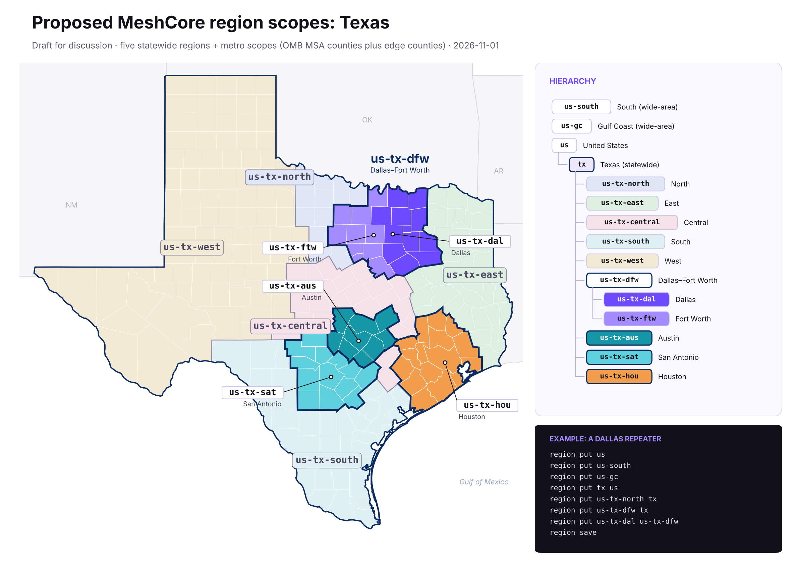

# MeshCore region scopes for Texas: draft proposal

_Draft for discussion · 2026-10-31 · adapted and simplified from the PNW region strategy at https://gessaman.com/meshcore/regions/_



## Hierarchy

`south`, `gc` and `tx` are siblings directly under `us`. `south` and `gc` are broad scopes for wide-area traffic, and `tx` holds the Texas metro scopes.

| Scope | Name | Parent | Covers |
|---|---|---|---|
| `us` | United States | (root) | Whole country |
| `south` | South | `us` | Broad, high-level scope for wide-area communication across southern states |
| `gc` | Gulf Coast | `us` | Broad, high-level scope for wide-area communication along the Gulf Coast. Sibling of `south` and `tx` |
| `tx` | Texas | `us` | All of Texas. Also the catch-all for any area without its own metro scope yet |
| `dfw` | Dallas–Fort Worth | `tx` | DFW metro plus edge counties (22 counties) |
| `dal` | Dallas | `dfw` | Collin, Dallas, Denton, Ellis, Hunt, Kaufman, Rockwall · edge: Fannin, Grayson, Henderson, Navarro, Van Zandt |
| `ftw` | Fort Worth | `dfw` | Johnson, Parker, Tarrant, Wise · edge: Cooke, Hill, Hood, Jack, Palo Pinto, Somervell |
| `asa` | Austin–San Antonio | `tx` | Austin and San Antonio metros plus edge counties (22 counties) |
| `aus` | Austin | `asa` | Bastrop, Caldwell, Hays, Travis, Williamson · edge: Blanco, Burnet, Lee, Milam |
| `sat` | San Antonio | `asa` | Atascosa, Bandera, Bexar, Comal, Guadalupe, Kendall, Medina, Wilson · edge: Frio, Gillespie, Gonzales, Karnes, Kerr |
| `hou` | Houston | `tx` | Austin, Brazoria, Chambers, Fort Bend, Galveston, Harris, Liberty, Montgomery, San Jacinto, Waller · edge: Colorado, Grimes, Matagorda, Walker, Washington, Wharton |

Each metro starts from its OMB Metropolitan Statistical Area counties (Dallas and Fort Worth use the two MSA divisions) and adds the outlying counties along its edge, so repeaters on the fringe join the metro instead of falling back to `tx`. The edge counties are a first pass and easy to adjust. El Paso, the Valley and other areas stay in `tx` until a local community asks for a scope.

## What can sit under `tx`

Every scope under `tx` has to be one of these three kinds:

1. **A major metro area.** This is a metro scope named for the whole area, such as `dfw` for Dallas–Fort Worth.
2. **A grouping of IATA codes.** This joins neighboring airport-code areas under one scope, such as `asa`, which groups `aus` and `sat`.
3. **A single IATA code.** This is one city or area named by its airport code, such as `hou`, `dal`, `ftw`, `aus` or `sat`.

Areas that don't fit one of these stay in `tx` until they do. Future scopes follow the same rule, for example `elp` (El Paso), `crp` (Corpus Christi) or a grouping for the Rio Grande Valley built from `hrl`, `mfe` and `bro`.

## What we kept from the PNW document

- **Short, flat, lowercase names.** Use only a–z, 0–9 and `-`, with three letters or fewer where possible. Under `tx`, names follow the rule above. Above `tx`, plain abbreviations are fine (`south`, `gc`). A name is just `dal`, not `us-gc-tx-dfw-dal`; the hierarchy comes from the parent field. Names have to be unique across the mesh.
- **Every repeater carries its full ancestry.** Firmware matches traffic on each region's own key and never looks at the parent. A repeater with only `dal` won't forward `dfw` or `tx` traffic, so each level needs its own `region put`.
- **Scope to your audience.** Use the smallest scope that reaches the people you're talking to. Local chat goes on `dal`/`ftw`/`aus`/`sat`, metro-wide traffic on `dfw`/`asa`, and statewide traffic on `tx`. Bots should flood on a scope, never unscoped.
- **No airtime cost.** Region names never go over the air. Packets carry only small transport codes derived from the region name.

## Example repeater configs

Dallas repeater (firmware 1.15.0+):

```
region put us
region put south us
region put gc us
region put tx us
region put dfw tx
region put dal dfw
region save
```

San Antonio repeater:

```
region put us
region put south us
region put gc us
region put tx us
region put asa tx
region put sat asa
region save
```

Every Texas repeater carries `us`, `south`, `gc` and `tx`, so wide-area traffic on the broad scopes reaches the whole state. A rural repeater outside any metro stops at `region put tx us`. A Houston repeater ends with `region put hou tx`. On firmware 1.14.x and earlier, add `region allowf <name>` after each `put`.

**Keep unscoped traffic for now.** Unscoped traffic uses the reserved root region `*`, and repeaters allow flood on it by default. Do not remove or deny flood on `*` on any repeater yet. Many nodes run older firmware or haven't set a region scope, and they still depend on unscoped flood. We'll decide on a later date for removing `*` once region scopes are widely adopted.

**Config tooling comes later.** Once there's enough agreement on the rules for how regions work and how they're defined, we can build tooling to generate the exact list of commands each user needs to enter on their repeater. Until then, use the examples above as a template.

## Scoping per channel

Repeaters carry the region tags, but the scope a message is sent on is chosen by the sender. Companions (phones) don't hold region tags themselves. Instead, each channel can have its own scope (Set Region Scope on the channel), and there's an app-wide default for everything else under Settings → Experimental → Default Region Scope.

This lets each channel match its audience:

| Channel | Suggested scope | Why |
|---|---|---|
| Public | `tx` or unscoped (`*`) | General chat that anyone in the state should be able to see |
| `#weather` | Local metro or city, e.g. `dfw` or `aus` | Alerts for Houston aren't useful in Dallas |
| `#bot` | Local metro or city, e.g. `hou` or `sat` | Bot replies and automated posts stay near the people using them |

A Fort Worth user might keep Public on `tx`, set `#weather` to `dfw` and set `#bot` to `ftw`. They still see statewide chat, but they won't get weather updates or bot output from Austin or Houston.

**Not every area needs its own scope.** Most conversation can stay in a local metro scope or in `tx`. An area only needs its own scope once it starts seeing excessive unwanted traffic from elsewhere. Until then, it's simpler to stay in `tx` and add a scope later if it's needed.

## Open questions

1. **Which states are in `south` and `gc`?** Both are broad, high-level scopes for wide-area communication, not local traffic. Every Texas repeater carries both, so it relays wide-area traffic. Which other states join them is still open.
2. **Uppercase vs lowercase.** The original ask used DFW/ASA. The convention is lowercase, so this draft uses `dfw` and `asa`.
3. **Edge counties.** Are the right outlying counties included? Bell (Killeen–Temple) and Jefferson (Beaumont) are left in `tx` for now.
4. **Next metros.** Likely candidates for the next scopes are El Paso (`elp`), the Rio Grande Valley and Corpus Christi. Should `hou` get sub-regions?
5. **Ratification.** Who signs off on new scopes, so names stay unique and agreed?
